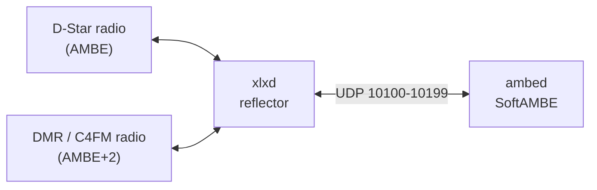

# 🌐 XLX SoftAMBE Installer

[](https://img.shields.io/badge/XLX-v2.5.3-blue) [](https://img.shields.io/badge/Dashboard-3.2.1-blue) [](#-softambe-software-transcoder) [](#-why-softambe) [](https://img.shields.io/badge/Debian-10%2B-red) [](LICENSE) [](https://img.shields.io/badge/maintained-yes-brightgreen)

**XLX multi-mode reflector with a built-in software transcoder**
D-Star ⇄ DMR ⇄ C4FM (YSF) — **no AMBE chip, no USB stick**

[Why SoftAMBE](#-why-softambe) • [Audio Features](#-audio-features) • [Quick Start](#-quick-start) • [Installation](#-installation-process) • [Tuning](#️-tuning-the-transcoder) • [Firewall](#️-firewall-configuration) • [User Manager](#-user-manager)

---

## 📖 About the Project

This project installs a complete XLX reflector with minimal user intervention, **including a software transcoder** so D-Star users can talk with DMR and C4FM (YSF) users on the same module. Developed by **Daniel K. ([PP5PK](https://www.qrz.com/db/PP5PK))**, it automates the setup of the XLX reflector created by [LX3JL](https://github.com/LX3JL/xlxd), adds the **SoftAMBE** transcoder to its `ambed` service and includes a customized dark theme dashboard.

Until now, linking D-Star with the other digital modes on an XLX reflector required DVSI AMBE chips (ThumbDV, DVstick or similar) plugged into the server. **SoftAMBE replaces that hardware with software**, with audio processing tuned on air with real radios.

**Upon completion, you'll have a fully functional public D-Star/YSF/DMR XLX reflector with cross-mode transcoding and a monitoring dashboard!** 🎉

> This project is based on the [XLX Debian Installer](https://github.com/PP5PK/XLX_Installer). Use that one if you do not need D-Star transcoding.

### 🎯 Key Highlights

- ✅ **D-Star ⇄ DMR ⇄ C4FM transcoding in software** — no AMBE chip or USB stick needed
- ✅ **Voice quality tuned on air** with Yaesu and Icom radios
- ✅ **Independent audio controls for each direction**: gain, equalizer and noise reduction
- ✅ **All audio settings in one commented file** (`/ambed/ambed.conf`), changed without recompiling
- ✅ **Works on VPS and cloud servers**, where USB hardware is not an option
- ✅ **Complete systemd service integration** replacing legacy init.d scripts
- ✅ **Dark theme dashboard** with improvements and modern UI
- ✅ **Optional Echo Test** (Parrot) service to audio tests
- ✅ **Compatible** with Debian 10+ (13 recommended), Ubuntu, RaspiOS, Armbian, etc...
- ✅ **Full uninstall support** with optional SSL certificate removal
- ✅ **Built-in User Manager** for whitelist, dashboard access and RadioID database
- ✅ **Residual installation detection** — automatically cleans up incomplete or failed installs before proceeding
- ✅ **Safe cancellation** — type `X` at any prompt to abort without leaving the system in an inconsistent state

---

## 💡 Why SoftAMBE

D-Star uses the AMBE vocoder, while DMR and C4FM use AMBE+2. To let them talk to each other, the reflector must decode one and re-encode the other in real time. Traditionally this is done by DVSI chips; SoftAMBE does it in software.

|                              | DVSI hardware (ThumbDV, DVstick…)        | SoftAMBE                                         |
| ---------------------------- | ---------------------------------------- | ------------------------------------------------ |
| **Hardware to buy**          | One USB device per few channels          | None                                             |
| **VPS / cloud servers**      | Not possible (needs USB)                 | ✅ Works anywhere                                 |
| **Simultaneous streams**     | Limited by the number of chips           | 1 to 16, limited only by CPU                     |
| **Drivers**                  | FTDI driver, `ftdi_sio` conflicts        | None                                             |
| **Audio tuning**             | Fixed gain per direction, at compile time | Gain, EQ and noise reduction per direction, in a config file |
| **Points of failure**        | USB device, cable, hub, power            | None beyond the server itself                    |
| **Processing time**          | Depends on the device                    | ≈ 3 ms per 20 ms voice frame (measured)          |
| **CPU use**                  | Minimal                                  | ≈ 8% of one x86_64 core per active stream        |

If DVSI hardware is also present, `ambed` uses the hardware channels first and the software channels only when they are all busy.

> **Patents:** AMBE and AMBE+2 are DVSI technologies. Check the patent situation in your country before enabling the software transcoder.

---

## 🎧 Audio Features

SoftAMBE is not just a vocoder swap: its audio chain was measured and tuned with on-air recordings from real radios (Yaesu FT-1DR on C4FM, Icom on D-Star), so voice sounds clear and natural in **both directions**.

### 🔊 Gain inside the encoder — no hiss, no clipping

Radios decode a software encoder's audio at very different levels than its own decoder suggests, so each direction needs a large level correction (around -20 dB towards DMR/YSF and +17 dB towards D-Star). Applying that to the audio samples, as usual, makes quiet passages fall under the vocoder's analysis floor (heard as a constant hiss in pauses) or clips the peaks.

SoftAMBE applies the gain **inside the encoder**, on its quantized gain parameter, so the voice analysis always works with full-scale audio. Measured speech-to-pause ratio on a test signal with background noise:

| Direction                | Gain on the audio samples | SoftAMBE (gain in the encoder) |
| ------------------------ | ------------------------- | ------------------------------ |
| D-Star → DMR/YSF, -20 dB | 23.7 dB                   | **33.5 dB**                    |
| DMR/YSF → D-Star, +17 dB | 28.8 dB (with clipping)   | **32.9 dB**                    |

### 🎚️ Equalizer — independent for each direction

Each direction has its own equalizer: a low cut that removes boominess and a broad presence boost (around 1.8 kHz by default) that brings clarity back to muffled voices. It is off by default, ready for operators who want a brighter or warmer sound on their reflector.

### 🔇 Noise reduction — independent for each direction

A downward expander (smart noise gate) lowers the background noise when nobody is talking, without cutting words:

- it **opens instantly** when speech returns,
- **holds** for a moment after each word,
- then **fades out smoothly** into silence.

On a test signal with room noise, it lowers the noise in pauses by about **10 dB** without changing the speech level. It is on by default for DMR/YSF → D-Star, where the large gain would otherwise raise the background noise.

### 🗂️ Everything in one file

Every audio setting lives in `/ambed/ambed.conf`, each with a one-line description of what raising or lowering it does, its range and its default. Change, restart, listen — no recompiling. See [Tuning the Transcoder](#️-tuning-the-transcoder).

---

## ✨ Features

| Feature                    | Description                                                     |
| -------------------------- | --------------------------------------------------------------- |
| 🔄 **Multi-Protocol**       | Native support for D-Star, C4FM (YSF), and DMR                  |
| 🔁 **SoftAMBE Transcoder**  | D-Star ⇄ DMR/YSF transcoding in software, no AMBE chip          |
| 🎚️ **Per-direction Audio**  | Gain, equalizer and noise reduction for each direction          |
| 🎨 **Custom Dashboard**     | Dark theme with enhanced monitoring capabilities                |
| 🔊 **Echo Test**            | Optional Parrot service for audio testing                       |
| 🔒 **SSL Ready**            | Automated SSL certificate setup with Certbot                    |
| 📊 **Real-time Monitoring** | Live connection tracking and statistics                         |
| 🌍 **YSF Auto-link**        | Configurable automatic linking for YSF                          |
| 🎯 **Auto-update**          | Automatic real-time users database setup                        |
| 👥 **User Manager**         | Terminal tool to manage users, whitelist and passwords          |
| 🧹 **Smart Cleanup**        | Detects and removes residual files from failed installs         |

### ✔ Dashboard Features

The included dashboard is a dark-theme fork with major improvements:

- Real-time multi-TX module detection with pulsing highlight animation and live TX timers
- Live duration counter for connected stations, updating every second without page reload
- Responsive layout for desktop and mobile
- 30‑day activity history and module activity chart (via Chart.js, independent 60-second refresh)
- SQLite operator database (call, name, city) displayed in Recent Activity and Connected Stations tabs
- Filter-aware auto-refresh — pauses when a callsign or module filter is active
- Browser tab badge showing connected station count and active TX callsign
- Hidden tabs support and others via `config.inc.php`

### ✔ Systemd Integration

The installer provides native **systemd services**, replacing original XLXD `init.d` behavior:

- `xlxd.service`
- `ambed.service` (SoftAMBE transcoder)
- `xlx_log.service`
- `update_XLX_db.service` (update timers)
- `xlxecho.service` (if Echo Test is enabled)

This brings better reliability, logging, restart behavior, and dependency control.

---

## 📋 Requirements

Before installation, ensure you have:

- [x] Debian-based system or VPS with latest updates
- [x] Stable internet connection with **fixed public IP**
- [x] Firewall management capabilities
- [x] **FQDN** for dashboard (e.g., `xlxbra.net`)
- [x] Unique **3-digit XLX ID** (check availability [here](https://xlxbra.net/index.php?show=reflectors))
- [x] For the transcoder: a CPU with some headroom — about 8% of one modern x86_64 core per simultaneous stream. Small boards such as the Raspberry Pi Zero can run the reflector itself, but have not been tested with the transcoder.

### 🔍 Finding Available Reflector Suffixes

Visit any active reflector dashboard to see which XLX suffixes are in use. Any unlisted suffix is available!

---

## 🚀 Quick Start

```bash
# Update system
sudo apt update && sudo apt full-upgrade -y

# Install prerequisites
sudo apt install git -y

# Clone repository
cd /usr/src/
sudo git clone https://github.com/PP5PK/XLX-SoftAMBE_Installer.git

# Run installer
cd XLX-SoftAMBE_Installer/ && sudo chmod +x *.sh
sudo ./installer.sh
```

---

## 📦 Installation process

[](https://cloud.dvbr.net/images/XLX_Install_Process.jpg)

### Step 1: Configure Firewall Ports

**Before running the installer**, ensure all required ports are open and forwarded (see [Firewall Configuration](#️-firewall-configuration)).

### Step 2: Run Installation

Execute the commands from the [Quick Start](#-quick-start) section above.

### Step 3: Configuration Prompts

The installer will request the following information:

| #  | Prompt                     | Example               | Default           |
| --- | -------------------------- | --------------------- | ----------------- |
| 01 | 3-digit XLX reflector      | `300`, `US1`, `BRA`   | -                 |
| 02 | Dashboard FQDN             | `xlxbra.net`          | -                 |
| 03 | Sysop email address        | `xlxref@gmail.com`    | -                 |
| 04 | Sysop callsign             | `PP5PK`               | -                 |
| 05 | Reflector country          | `Germany`             | -                 |
| 06 | Time Zone                  | `Europe/Berlin`       | Detected          |
| 07 | Comment for XLX list       | `XLX300 Reflector...` | -                 |
| 08 | Custom tab name            | `XLXBRA Dashboard...` | -                 |
| 09 | Custom footnote            | `Maintained by...`    | -                 |
| 10 | Install SSL?               | `Y/N`                 | Y                 |
| 11 | Install Echo Test?         | `Y/N`                 | Y                 |
| 12 | Number of modules          | `1-26`                | 5                 |
| 13 | YSF UDP port               | `1-65535`             | 42000             |
| 14 | YSF Wires-X frequency (Hz) | `433125000`           | 433125000         |
| 15 | Enable YSF auto-link?      | `Y/N`                 | Y                 |
| 16 | YSF auto-link module       | `A-Z`                 | C                 |
| 17 | Install SoftAMBE transcoder? | `Y/N`               | Y                 |
| 18 | Simultaneous transcoded streams | `1-16`           | CPU cores (max 4) |

> **Tip:** At any prompt, type `X` and press **[ENTER]** to safely cancel the installation. No changes will be made to the system.

### Step 4: Completion ✅

The installation proceeds automatically. Once complete, your reflector and transcoder will be operational and ready to accept connections!

### 🔍 Residual Installation Detection

If the installer detects files from a previous incomplete or failed installation, it will automatically identify and remove them before proceeding. This ensures a clean environment without requiring manual intervention, even if a prior install did not complete successfully.

If an existing **complete** installation is found, the installer will offer to launch the uninstaller directly, so you can perform a clean reinstallation without leaving the script.

---

## 🔁 SoftAMBE Software Transcoder

### How it works



For each transmission that must change mode, `ambed` runs this chain, with its own settings for each direction:

```
D-Star → DMR/YSF :  decode AMBE   → [EQ] → [noise gate] → encode AMBE+2 (with gain)
DMR/YSF → D-Star :  decode AMBE+2 → [EQ] → [noise gate] → encode AMBE   (with gain)
```

### What the installer does

- Clones `xlxd` unchanged from [PP5PK/xlxd](https://github.com/PP5PK/xlxd) and applies `patches/xlxd-ambed-softambe.patch`, which adds the SoftAMBE backend to `ambed`.
- Builds `ambed` without hardware support (`make NO_FTDI=1`) and installs it to `/ambed/`.
- Creates `/ambed/ambed.conf` with the tuned audio settings and the number of streams from question 18.
- Creates and starts `ambed.service`, before `xlxd.service`.
- If the patch no longer applies to the current `xlxd`, it warns and installs the reflector without the transcoder instead of stopping.

### Under the hood

SoftAMBE is based on the open source software vocoder from [DroidStar](https://github.com/nostar/DroidStar) by Doug McLain AD8DP: the [mbelib](https://github.com/szechyjs/mbelib) decoder, an AMBE/AMBE+2 encoder derived from OP25, and Pavel Yazev's IMBE analysis. **No firmware or proprietary code is used.** The gain-in-encoder method, the equalizer, the noise gate and the on-air tuning were added in this project. Technical details are in `ambed/SOFTWARE_VOCODER.md` in the patched source.

---

## 🎛️ Tuning the Transcoder

All audio settings are in **`/ambed/ambed.conf`**. Each line has a short description, its range and its default in brackets:

```ini
# --- DMR/YSF -> D-Star ---------------------------------------------------------

# GAIN = value > louder, value < quieter (dB, -24 to 24) [17]
AMBED_SOFT_GAIN_DMR_TO_DSTAR=17

# EQ = value > more treble, value < more bass (dB, 0 to 12, 0 = off) [0]
AMBED_SOFT_EQ_DMR_TO_DSTAR=0

# GATE = value > less noise in pauses, value < keeps quieter words
#        (dBFS, -90 to -1, 0 = off; -40 cuts more than -50) [-45]
AMBED_SOFT_GATE_DMR_TO_DSTAR=-45
```

Apply changes and check the values in use:

```bash
sudo nano /ambed/ambed.conf
sudo systemctl restart ambed xlxd
journalctl -u ambed -b | grep SoftAMBE
```

```
SoftAMBE DMR/YSF -> D-Star : gain 17 dB, equalizer off, expander -45 dBFS
SoftAMBE D-Star -> DMR/YSF : gain -20 dB, equalizer off, expander off
SoftAMBE equalizer : low cut 250 Hz, peak 1800 Hz | expander : ratio 2, max 20 dB, hold 100 ms, release 270 ms | idle reset 500 ms
```

### All settings

| Setting                         | Default               | What it does                                                   |
| ------------------------------- | --------------------- | -------------------------------------------------------------- |
| `AMBED_SOFT_PAIRS`              | answer to question 18 | simultaneous transcoded streams (1-16)                         |
| **D-Star → DMR/YSF**            |                       |                                                                |
| `AMBED_SOFT_GAIN_DSTAR_TO_DMR`  | `-20`                 | volume (dB, -24 to 24)                                         |
| `AMBED_SOFT_EQ_DSTAR_TO_DMR`    | `0`                   | presence / treble boost (dB, 0 to 12, `0` = equalizer off)     |
| `AMBED_SOFT_GATE_DSTAR_TO_DMR`  | `0`                   | noise gate threshold (dBFS, `0` = off)                         |
| **DMR/YSF → D-Star**            |                       |                                                                |
| `AMBED_SOFT_GAIN_DMR_TO_DSTAR`  | `17`                  | volume (dB, -24 to 24)                                         |
| `AMBED_SOFT_EQ_DMR_TO_DSTAR`    | `0`                   | presence / treble boost (dB, 0 to 12, `0` = equalizer off)     |
| `AMBED_SOFT_GATE_DMR_TO_DSTAR`  | `-45`                 | noise gate threshold (dBFS, `0` = off)                         |
| **Equalizer shape**             |                       | *both directions, only where EQ is not 0*                      |
| `AMBED_SOFT_EQ_LOWCUT_HZ`       | `250`                 | low cut against boominess (Hz, 0 to 600, `0` = none)           |
| `AMBED_SOFT_EQ_PEAK_HZ`         | `1800`                | centre of the boost (Hz, 500 to 3500)                          |
| **Noise gate shape**            |                       | *both directions, only where GATE is not 0*                    |
| `AMBED_SOFT_GATE_RATIO`         | `2`                   | strength: dB of cut per dB below the threshold (1 to 10)       |
| `AMBED_SOFT_GATE_MAX_DB`        | `20`                  | largest cut (dB, 0 to 40)                                      |
| `AMBED_SOFT_GATE_HOLD_MS`       | `100`                 | time it stays open after speech (ms, 0 to 1000)                |
| `AMBED_SOFT_GATE_RELEASE_MS`    | `270`                 | fade time into silence (ms, 20 to 2000)                        |
| **Vocoder**                     |                       |                                                                |
| `AMBED_SOFT_IDLE_RESET_MS`      | `500`                 | silence after which the vocoders start fresh (ms, 100 to 5000) |

Values out of range are clamped; invalid values fall back to the default and are reported in the log. Deleting a line also restores its default.

### Quick tuning guide

Change one setting at a time, in steps of 2-3, and test on air between changes.

| What you hear                                  | Direction        | What to change                                  |
| ---------------------------------------------- | ---------------- | ----------------------------------------------- |
| D-Star too loud or distorted on DMR/C4FM radios | D-Star → DMR/YSF | lower `GAIN_DSTAR_TO_DMR` (e.g. -20 → -22)      |
| DMR/C4FM too quiet on D-Star radios            | DMR/YSF → D-Star | raise `GAIN_DMR_TO_DSTAR` (e.g. 17 → 19)        |
| Voice muffled or boomy                         | that direction   | set `EQ_…` to 6-9; raise `EQ_LOWCUT_HZ` if still boomy |
| Voice too sharp or thin                        | that direction   | lower `EQ_…`, or lower `EQ_PEAK_HZ`             |
| Hiss or background noise in pauses             | that direction   | enable or raise `GATE_…` (e.g. -45 → -40)       |
| Quiet words or word endings cut                | that direction   | lower `GATE_…` (e.g. -45 → -50) or raise `GATE_HOLD_MS` |
| Silence sounds unnaturally "dead"              | both             | lower `GATE_MAX_DB` (e.g. 20 → 12)              |

> **Tip:** the easiest test is two radios on the same module, one D-Star and one DMR or C4FM: talk on one, listen on the other, then swap. Keep them a few metres apart so the speaker of one does not feed the microphone of the other.

### Updating the transcoder

To bring an existing installation to the latest SoftAMBE version, keeping your `ambed.conf`:

```bash
cd /usr/src/XLX-SoftAMBE_Installer && sudo git pull
cd /usr/src/xlxd
sudo git checkout -- ambed && sudo git clean -fdq ambed
sudo git apply --whitespace=nowarn /usr/src/XLX-SoftAMBE_Installer/patches/xlxd-ambed-softambe.patch
cd ambed && sudo make clean && sudo make NO_FTDI=1
sudo systemctl stop ambed && sudo make install
sudo systemctl start ambed && sudo systemctl restart xlxd
```

> ⚠️ Do not skip `make clean`: the `ambed` makefile does not rebuild everything when a header changes, and a partial rebuild can crash `ambed` at startup.

---

## 🛡️ Firewall Configuration

### Required Open Ports

| Port        | Type | Description                    |
| ----------- | ---- | ------------------------------ |
| 22          | TCP  | SSH                            |
| 80          | TCP  | HTTP                           |
| 443         | TCP  | HTTPS                          |
| 8080        | TCP  | RepNeT                         |
| 20001-20005 | TCP  | DPlus protocol                 |
| 40001       | TCP  | ICom G3                        |
| 8880        | UDP  | DMR+ DMO mode                  |
| 10001       | UDP  | JSON interface XLX Core        |
| 10002       | UDP  | XLX interlink                  |
| 10100       | UDP  | AMBE controller                |
| 10101-10199 | UDP  | AMBE transcoding               |
| 12345-12346 | UDP  | ICom Terminal presence/request |
| 20001-20005 | UDP  | DPlus protocol                 |
| 21110       | UDP  | Yaesu IMRS protocol            |
| 30001       | UDP  | DExtra protocol                |
| 30051       | UDP  | DCS protocol                   |
| 40000       | UDP  | Terminal DV                    |
| 42000       | UDP  | YSF protocol                   |
| 62030       | UDP  | MMDVM protocol                 |

> The AMBE ports (10100-10199) are used between `xlxd` and `ambed`. With the transcoder on the same server they only need to be reachable locally (127.0.0.1).

---

## 📂 File Locations

| Type                         | Location |
| ---------------------------- | -------- |
| **Installation**             | `/xlxd/` `/ambed/` |
| **Transcoder settings**      | `/ambed/ambed.conf` |
| **Source Files & Folders**   | `/usr/src/xlxd/` `/usr/src/xlxd/ambed/` `/usr/src/XLXEcho/` `/usr/src/XLX_Dark_Dashboard/` `/usr/src/XLX-SoftAMBE_Installer/` `/usr/local/bin/update_db.sh` `/usr/local/bin/xlx_log.sh` |
| **Log Files**                | `/var/log/xlxd*` `/var/log/xlx.log` `/var/log/xlxecho.log` `/var/log/update_XLX_db.log` — transcoder: `journalctl -u ambed` |
| **Services**                 | `/etc/systemd/system/xlxd.service` `/etc/systemd/system/ambed.service` `/etc/systemd/system/xlxecho.service` `/etc/systemd/system/xlx_log.service` `/etc/systemd/system/update_XLX_db.service` `/etc/systemd/system/update_XLX_db.timer` |
| **Dashboard**                | `/var/www/html/xlxd/` |
| **Configuration**            | `/var/www/html/xlxd/pgs/config.inc.php` `/etc/logrotate.d/xlx_logrotate.conf` `/xlxd/callinghome.php` `/xlxd/xlxd.blacklist` `/xlxd/xlxd.whitelist` `/xlxd/xlxd.interlink` `/xlxd/xlxd.terminal` |
| **User Manager**             | `/xlxd/users_db/reflector_user_manager.sh` |
| **RadioID Database**         | `/xlxd/users_db/users_base.csv` `/xlxd/users_db/user.csv` |
| **Dashboard Authentication** | `/var/www/restricted/.htpasswd` |

---

## 🔑 The callinghome.php File — Reflector Identity & Ownership

After installation, the file `/xlxd/callinghome.php` is created automatically. This file is critical to the identity and ownership of your reflector and should be treated with care.

### What it does

`callinghome.php` contains a unique cryptographic hash that:

- **Proves ownership** of your specific reflector ID (e.g., XLX300) to the global XLX network
- **Prevents conflicts** — no other operator can register the same reflector ID while your hash is the valid one
- **Controls dashboard visibility** — the green thumbs-up indicator on the public reflector list, confirming that your reflector is active and legitimate, depends on this file being valid and matching the one registered on the network

### ⚠️ Critical: Back up this file before reinstalling

If you need to reinstall your reflector, **back up `/xlxd/callinghome.php` before running the uninstaller**:

```bash
sudo cp /xlxd/callinghome.php ~/callinghome.php.bak
```

After reinstalling, replace the newly generated file with your backup:

```bash
sudo cp ~/callinghome.php.bak /xlxd/callinghome.php
```

This ensures your reflector is immediately recognized as the legitimate owner of its ID on the global network.

> 💡 Back up `/ambed/ambed.conf` too if you tuned the transcoder audio.

### What happens if you don't back it up

If the backup is lost and a new `callinghome.php` is generated after reinstallation:

- **New reflectors** — will appear online immediately, as there is no prior hash registered for that ID
- **Existing reflectors** — the new hash must be validated by the network, which takes approximately **3 days**. During this period, the reflector will still be functional and accept connections, but may not display the green active indicator on the public list until validation is complete

---

## 🔧 Managing the Reflector

### Service Control

```bash
# Start the reflector
sudo systemctl start xlxd.service

# Stop the reflector
sudo systemctl stop xlxd.service

# Restart the reflector
sudo systemctl restart xlxd.service

# Check status
sudo systemctl status xlxd.service

# Transcoder status
sudo systemctl status ambed.service
```

### Real-time Monitoring

```bash
# Watch live logs
sudo tail -f /var/log/xlx.log

# Watch the transcoder (streams opening/closing, packets lost)
sudo journalctl -u ambed -f
```

---

## 🔍 Troubleshooting

### D-Star and DMR/C4FM users cannot hear each other

1. Check that the transcoder is running and which settings it loaded:
   ```bash
   sudo systemctl status ambed.service
   journalctl -u ambed -b | grep -E 'SoftAMBE|started'
   ```
   The log must show `Opening SoftAMBE software vocoder : N pair(s)`. If it shows no pairs, check `AMBED_SOFT_PAIRS` in `/ambed/ambed.conf`.
2. During a cross-mode transmission, `journalctl -u ambed -f` should show `Stream Open`, a `Vocodec channel SoftAMBE…` line and, at the end, `0 of N packets lost`.
3. If the installer warned that the SoftAMBE patch did not apply, follow [Updating the transcoder](#updating-the-transcoder) after a `git pull`.

### Reflector Not Appearing in the Public List

After a successful installation, your reflector should appear on any XLX dashboard (e.g., [xlxbra.net](https://xlxbra.net)) within a few minutes. If it does not, the most common cause is an **IP address mismatch** in the service configuration.

#### Understanding the IP Configuration

The file `/etc/systemd/system/xlxd.service` contains a line like:

```
ExecStart=/xlxd/xlxd XLX300 192.168.1.10 127.0.0.1
```

The **second argument** (the first IP address) is critical — it must be the IP that has **direct outbound internet access**. The last one (`127.0.0.1`) is the address of the transcoder and should stay as it is. There are two scenarios:

| Setup | IP to use | Example |
|-------|-----------|---------|
| **Server behind a LAN router** (ports forwarded to the server) | Local/internal IP | `192.168.1.10` |
| **VPS or server with public IP assigned directly to the NIC** | Public IP | `203.0.113.45` |

The installer attempts to detect the correct IP automatically. However, in some environments — particularly those with complex networking, multiple interfaces, or NAT — it may not detect this correctly.

#### How to Fix It

**1. Check which IP is currently configured:**
```bash
grep ExecStart /etc/systemd/system/xlxd.service
```

**2. Identify the correct IP for your setup:**
```bash
# Your local/internal IP
hostname -I | awk '{print $1}'

# Your public IP (as seen from the internet)
curl -s https://v4.ident.me
```

**3. Edit the service file with the correct IP:**
```bash
sudo nano /etc/systemd/system/xlxd.service
```

**4. Apply the change and restart:**
```bash
sudo systemctl daemon-reload
sudo systemctl stop xlxd.service
sudo systemctl start xlxd.service
```

**5. Verify the service is running:**
```bash
sudo systemctl status xlxd.service
```

After restarting, allow a few minutes for the reflector to register and appear on the public list.

---

## 👥 User Manager

The installer includes `reflector_user_manager.sh`, a unified terminal tool for all user administration tasks. Instead of running separate scripts, everything is available from a single two-level interactive menu.

```bash
sudo /xlxd/users_db/reflector_user_manager.sh
```

### Menu Structure

```
Main menu
├── 1) Database (RadioID)
│   ├── 1) Add / Edit record
│   ├── 2) Delete record
│   ├── 3) List records by Callsign
│   ├── 4) Search records (filter)
│   ├── 5) Create / Update SQL database
│   └── X) Back
└── 2) Access Control
    ├── 1) Add user       (whitelist + dashboard)
    ├── 2) Reset password (dashboard)
    ├── 3) Remove user    (whitelist + dashboard)
    ├── 4) Look up user   (whitelist + dashboard)
    ├── 5) List pending   (password not yet changed)
    ├── 6) List whitelist (all callsigns)
    └── X) Back
```

### Key Capabilities

| Feature                   | Description                                                                                                   |
| ------------------------- | ------------------------------------------------------------------------------------------------------------- |
| 📋 **RadioID Database**    | Add, edit, delete and search records in `users_base.csv`                                                      |
| 🔍 **Filtered Search**     | Case-insensitive partial search by callsign, DMRID, name, city or country — with pagination (25 records/page) |
| 🔑 **Password Management** | Generate and reset secure 12-character dashboard passwords                                                    |
| 📡 **Whitelist Control**   | Add and remove callsigns from `xlxd.whitelist` with confirmation                                              |
| 🗂️ **Whitelist Listing**  | Display all active whitelist entries in auto-sized columns                                                    |
| ⏳ **Pending List**        | Track users who have not yet changed their initial password                                                   |
| 🔄 **SQL Sync**            | Trigger `create_user_db.php` to rebuild the SQLite database from the CSV                                      |

> For full documentation see [REFLECTOR_USER_MANAGER.md](https://github.com/PP5PK/XLX-SoftAMBE_Installer/blob/master/REFLECTOR_USER_MANAGER.md).

---

## 🎯 Optional Steps

### 📝 Register Your YSF Reflector

To list your reflector on YSF hosts:

1. Visit [dvref.com](https://dvref.com)
2. Follow the registration instructions

### 🔒 Manual SSL Setup

If you skipped automatic SSL during installation:

1. Visit the [Certbot website](https://certbot.eff.org)
2. Follow the simple instructions
3. Ensure TCP ports 80 and 443 are open and forwarded

---

## 🧹 Uninstall (Full Removal)

The uninstaller is located at `templates/uninstaller.sh` within the installer directory. It can be launched manually or directly from the installer if an existing installation is detected during a new install attempt.

```bash
cd /usr/src/XLX-SoftAMBE_Installer/templates
sudo ./uninstaller.sh
```

This removes:

- systemd services and timers (including `ambed.service`)
- dashboard and web files
- reflector and transcoder binaries (`/xlxd/`, `/ambed/`)
- configuration files (including `/ambed/ambed.conf`)
- Apache virtual host integration
- cron jobs and timers
- log files and directories
- SSL certificate (optional — the uninstaller will ask)

> **Note:** The uninstaller will offer to remove the SSL certificate issued for your dashboard domain. If you plan to reuse the same domain, you may choose to keep it.

> **Tip:** Type `X` at any prompt during uninstallation to abort safely without making changes.

> ⚠️ **Remember** to back up `/xlxd/callinghome.php` (and `/ambed/ambed.conf`, if you tuned it) before uninstalling if you plan to reinstall. See the [callinghome.php section](#-the-callinghomephp-file--reflector-identity--ownership) for details.

---

## 🤝 Credits & Related Projects

| Project                     | Author                                                  | Description                                  |
| --------------------------- | ------------------------------------------------------- | -------------------------------------------- |
| **XLX Reflector**           | [LX3JL](https://github.com/LX3JL/xlxd)                  | Original XLX reflector and `ambed` software  |
| **XLX Forum Home**          | [LX1IQ](https://xlxbbs.epf.lu)                          | Official XLX Forum / Support                 |
| **DroidStar**               | [AD8DP](https://github.com/nostar/DroidStar)            | Open source software AMBE/AMBE+2 vocoder     |
| **mbelib**                  | [szechyjs](https://github.com/szechyjs/mbelib)          | AMBE/IMBE decoder library                    |
| **IMBE vocoder**            | Pavel Yazev                                             | Fixed-point IMBE speech analysis             |
| **OP25**                    | OP25 project                                            | Origin of the AMBE/AMBE+2 encoder            |
| **XLX Dark Dashboard**      | [PP5PK](https://github.com/PP5PK/XLX_Dark_Dashboard)    | Dark themed XLX dashboard                    |
| **Original Installer Idea** | [N5AMD](https://github.com/n5amd/xlxd-debian-installer) | Initial Debian installer concept             |
| **YSF Registration**        | [KC1AWV](https://dvref.com)                             | YSF Reflector registration service           |
| **Echo Test Service**       | [Narspt](https://github.com/narspt/XLXEcho)             | XLX Echo Test implementation                 |
| **SSL Certification**       | [Certbot](https://certbot.eff.org/)                     | Free SSL/TLS certificates                    |
| **This Installer & SoftAMBE** | [PP5PK](https://pp5pk.net)                            | Automated installation and software transcoder |

---

## 📞 Support

If you encounter issues or have questions:

- 📧 Contact the maintainer: [PP5PK](https://t.me/Whrebe)
- 🐛 Open an issue on GitHub — for audio questions, include the output of `journalctl -u ambed -b | grep SoftAMBE` and, if possible, a short recording
- 💬 Join the amateur radio community discussions

---

## 📄 License

This project is open source and available for use by the amateur radio community.
Released under the **The Unlicense** License. See [`LICENSE`](LICENSE) for details.
The SoftAMBE patch includes third-party code under its own licenses (ISC for the DroidStar/OP25 vocoder code, GPL for the IMBE analysis); see the headers in the patched source.

> **Patents:** AMBE and AMBE+2 are DVSI technologies. Check the patent situation in your country before enabling the software transcoder.

---

## ⭐ Community Support

**Made with ❤️ by the Amateur Radio Community**

⭐ If you find this project useful, please consider starring it on GitHub!
Contributions and pull requests are welcome.
